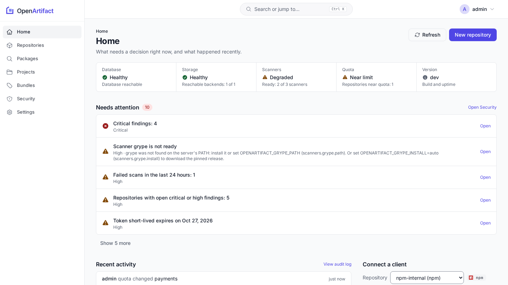
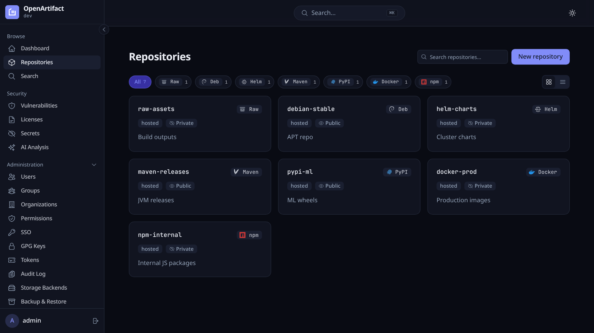
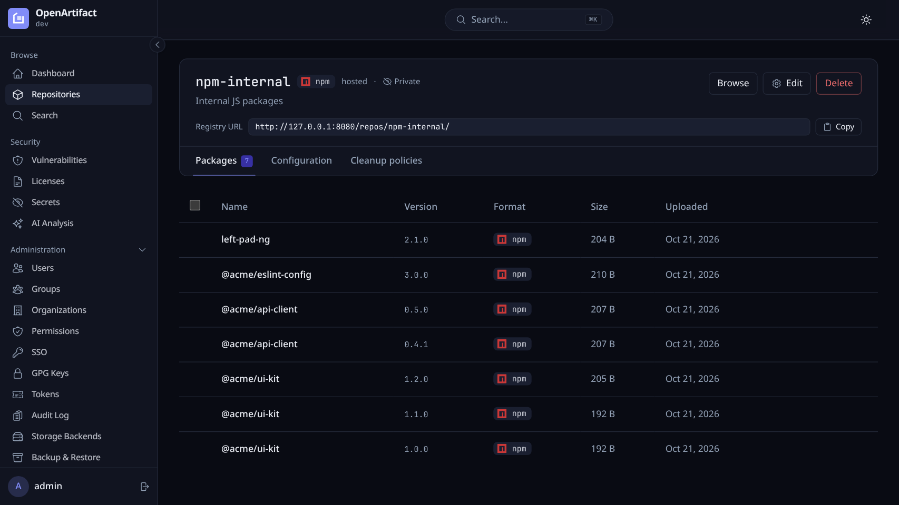

<!--
SPDX-FileCopyrightText: The OpenArtifact Authors

SPDX-License-Identifier: AGPL-3.0-or-later
-->

<p align="center">
  
</p>

<h1 align="center">OpenArtifact</h1>

<p align="center">
  <b>Self-hosted artifact repository for 16 package formats.</b><br>
  One Go binary, embedded web UI, PostgreSQL. Hosted, proxy and group repositories with RBAC, SSO and security scanning.
</p>

<p align="center">
  <a href="https://github.com/openartifact/openartifact/actions/workflows/ci.yml"></a>
  <a href="LICENSE"></a>
  
  <a href="https://api.reuse.software/info/github.com/openartifact/openartifact"></a>
</p>

<p align="center">
  <a href="#quickstart">Quickstart</a> ·
  <a href="docs/formats/README.md">Formats</a> ·
  <a href="docs/getting-started/configuration.md">Configuration</a> ·
  <a href="https://openartifact.github.io/">Website</a> ·
  <a href="https://openartifact.github.io/latest/">Documentation</a> ·
  <a href="CONTRIBUTING.md">Contributing</a>
</p>

OpenArtifact stores and serves npm, PyPI, Maven, Docker/OCI, Helm, Debian, RPM,
Go, Cargo, NuGet, RubyGems, Conda, Conan, Ivy, sbt and raw files behind one URL
scheme and one permission model, on your own infrastructure. Free software under
the AGPL.

<p align="center">
  
</p>

<table>
  <tr>
    <td></td>
    <td></td>
  </tr>
</table>

## Formats

| Repository type | Formats |
|---|---|
| Hosted | all 16 (listed above) |
| Proxy (read-only mirror of an upstream) | Maven, Debian, RPM, raw |
| Group (ordered members, first hit wins) | Maven, raw |

Client URLs and setup per format: [docs/formats](docs/formats/README.md).

## Features

- Native client protocols for 16 formats; hosted, proxy (with serve-stale) and group repositories
- RBAC with users, groups, permission targets and API tokens; SSO via OIDC and SAML; projects
- SBOM (CycloneDX/SPDX), vulnerability scanning (OSV, Trivy, Grype), license compliance, secret detection
- Cleanup policies, storage quotas, artifact properties, release bundles with promotion pipelines
- Blob storage on filesystem, S3, GCS, Azure, Garage, SeaweedFS or an OCI registry; backups
- GPG-signed APT and RPM metadata; signed, attested release images
- Webhooks, audit log, Prometheus metrics, REST API with OpenAPI spec and Swagger UI
- `oa` CLI with Nexus/Artifactory import; optional MCP server and AI analysis (both off by default)

## Quickstart

```sh
cp docker/.env.example docker/.env      # set POSTGRES_PASSWORD
make docker-up    # docker compose up -d --build with version/commit/build time stamped
                  # (no dhi.io access? OPENARTIFACT_RUNTIME=distroless make docker-up)
```

The UI and API are on <http://localhost:8080>. The first start creates user
`admin` with a random password printed once to the server's stderr
(`docker compose -f docker/docker-compose.yml logs openartifact`). Change it at
first login.

On Kubernetes:

```sh
helm install openartifact oci://ghcr.io/openartifact/charts/openartifact
```

More: [installation](docs/getting-started/installation.md),
[configuration](docs/getting-started/configuration.md).

## Documentation

| Section | Contents |
|---|---|
| [Getting started](docs/getting-started/installation.md) | [Installation](docs/getting-started/installation.md) (Compose, Helm, binaries, first login), [configuration](docs/getting-started/configuration.md) (every setting), [upgrading](docs/getting-started/upgrading.md) |
| [Formats](docs/formats/README.md) | Client URLs and setup per format: [Maven](docs/formats/maven.md), [npm](docs/formats/npm.md), [PyPI](docs/formats/pypi.md), [Docker](docs/formats/docker.md), [Helm](docs/formats/helm.md), [Debian](docs/formats/debian.md), [RPM](docs/formats/rpm.md), [Go](docs/formats/go.md), [Cargo](docs/formats/cargo.md), [NuGet](docs/formats/nuget.md), [RubyGems](docs/formats/rubygems.md), [Conda](docs/formats/conda.md), [Conan](docs/formats/conan.md), [Ivy/sbt](docs/formats/ivy-sbt.md), [raw](docs/formats/raw.md) |
| [Repositories](docs/repositories/hosted-proxy-group.md) | [Hosted, proxy and group](docs/repositories/hosted-proxy-group.md), [cleanup and quotas](docs/repositories/cleanup-and-quotas.md), [properties](docs/repositories/properties.md), [release bundles](docs/repositories/release-bundles.md) |
| [Security](docs/security/authentication.md) | [Authentication](docs/security/authentication.md), [SSO](docs/security/sso.md), [RBAC](docs/security/rbac.md), [scanning](docs/security/scanning.md), [signing and release verification](docs/security/signing.md) |
| [Operations](docs/operations/storage.md) | [Storage](docs/operations/storage.md), [backup](docs/operations/backup.md), [monitoring](docs/operations/monitoring.md), [webhooks](docs/operations/webhooks.md), [performance](docs/operations/performance.md) |
| [Migration](docs/migration/nexus-artifactory.md) | Import from Nexus or Artifactory with `oa import` |
| [Integrations](docs/integrations/cli.md) | [`oa` CLI](docs/integrations/cli.md), [MCP server](docs/integrations/mcp.md), [REST API](docs/integrations/api.md), [AI analysis](docs/integrations/ai-analysis.md) |
| [Development](docs/development/README.md) | [Build, test, CI](docs/development/README.md), [architecture](docs/development/architecture.md) |

The documentation is published, per release, at <https://openartifact.github.io/> (search, version switcher, generated configuration, metrics, CLI and REST API reference). The same pages are readable here: the full page index is [docs/README.md](docs/README.md).

## Contributing, security, license

- Contributing: [CONTRIBUTING.md](CONTRIBUTING.md); conventions for humans and coding agents: [AGENTS.md](AGENTS.md)
- Security: report issues privately as described in [SECURITY.md](SECURITY.md)
- License: AGPL-3.0-or-later, see [LICENSE](LICENSE)
- Name and logo: see the [trademark policy](TRADEMARKS.md); to run under your own name use [white-label branding](docs/operations/branding.md)
