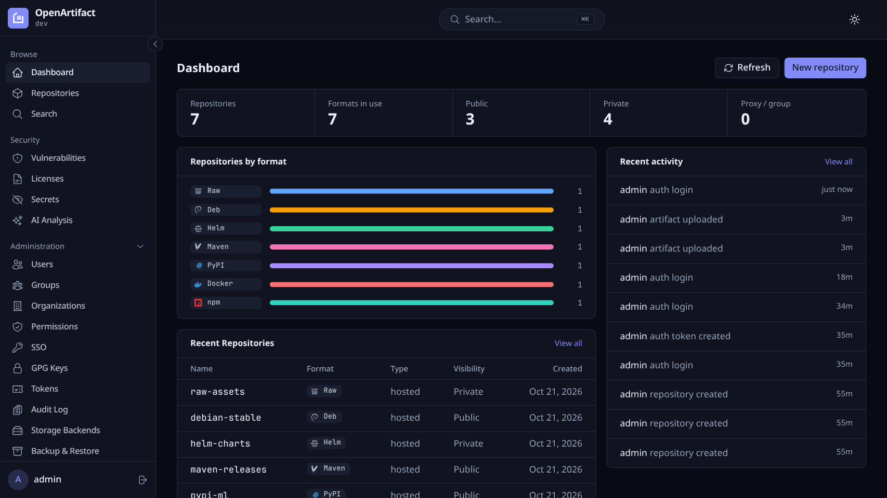
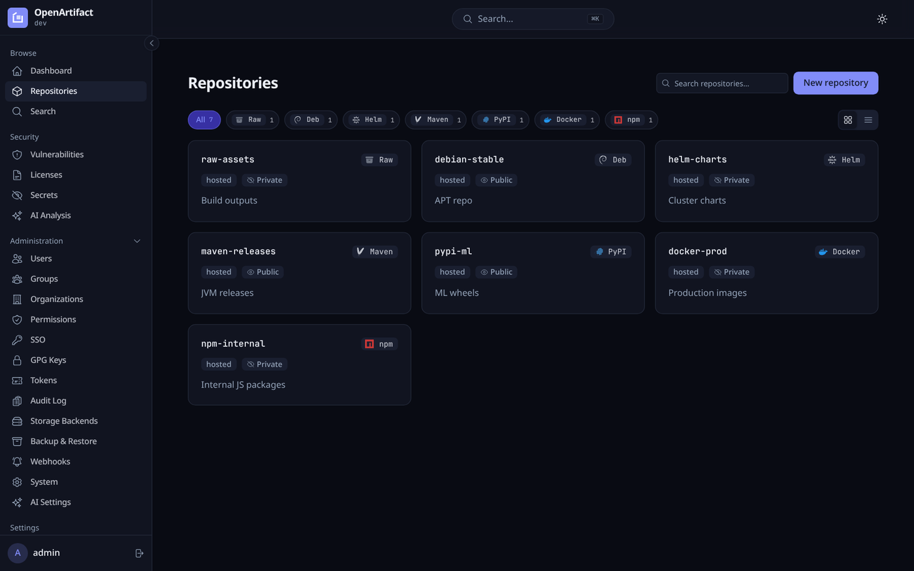

<!--
SPDX-FileCopyrightText: The OpenArtifact Authors

SPDX-License-Identifier: AGPL-3.0-or-later
-->

<p align="center">
  
</p>

<h1 align="center">OpenArtifact</h1>

<p align="center">
  <b>Self-hosted artifact repository for 16 package formats.</b><br>
  One Go binary, embedded web UI, PostgreSQL. Hosted, proxy and group repositories with RBAC, SSO and security scanning.
</p>

<p align="center">
  <a href="https://github.com/openartifact/openartifact/actions/workflows/ci.yml"></a>
  <a href="LICENSE"></a>
  
  <a href="https://api.reuse.software/info/github.com/openartifact/openartifact"></a>
</p>

<p align="center">
  <a href="#quickstart-docker-compose">Quickstart</a> ·
  <a href="#supported-formats">Formats</a> ·
  <a href="#configuration">Configuration</a> ·
  <a href="#cli">CLI</a> ·
  <a href="CONTRIBUTING.md">Contributing</a>
</p>

npm, PyPI, Maven, Docker/OCI, Helm, Debian, RPM, Go, Cargo, NuGet, RubyGems,
Conda, Conan, Ivy, sbt and raw files, behind one URL scheme and one permission
model, on your own infrastructure. Free software under the AGPL.

<p align="center">
  
</p>

<table>
  <tr>
    <td></td>
    <td></td>
  </tr>
  <tr>
    <td align="center">Repositories</td>
    <td align="center">Repository detail</td>
  </tr>
</table>

## Features

- 16 package formats (table below) as hosted repositories; proxy repositories for
  Maven, Debian, RPM and raw, and group repositories for Maven and raw
- RBAC with users, groups, permission targets, API tokens; SSO via OIDC and SAML
- SBOM generation (CycloneDX/SPDX), vulnerability scanning (OSV, Trivy, Grype),
  license compliance and secret detection
- Optional AI-assisted artifact analysis and an MCP server (disabled by default)
- Webhooks, cleanup policies, storage quotas, artifact properties, backups,
  release bundles with promotion pipelines, audit log, multi-tenancy (organizations)
- Blob storage: filesystem, S3, GCS, Azure, Garage, SeaweedFS, OCI registry
- GPG signing for APT and RPM metadata
- REST API with OpenAPI spec and Swagger UI; Prometheus metrics; `oa` CLI

## Supported formats

Repositories are served under `/repos/<repo-name>/...`, except where noted.
Replace `HOST` with your server (e.g. `http://localhost:8080`) and `REPO`
with the repository name.

| Format | Client URL |
|---|---|
| Maven | `HOST/repos/maven/REPO` |
| sbt | `HOST/repos/sbt/REPO` |
| Ivy | `HOST/repos/ivy/REPO` |
| Raw | `HOST/repos/raw/REPO/<path>` |
| npm | `HOST/repos/REPO/` |
| PyPI | `HOST/repos/REPO/simple/` (upload: `HOST/repos/REPO/legacy/`) |
| Docker / OCI | `HOST/v2/` registry API; the image name is the repository name |
| Helm | `HOST/repos/REPO/` (`index.yaml`, `charts/`) |
| Debian (APT) | `HOST/repos/REPO/` (`dists/`, `pool/`, `public.key`) |
| RPM (YUM/DNF) | `HOST/repos/REPO/` (`repodata/repomd.xml`, `Packages/`, `public.key`) |
| Go modules | `GOPROXY=HOST/repos/REPO` |
| Cargo | `HOST/repos/REPO/` (sparse index, `config.json`) |
| NuGet | `HOST/repos/REPO/v3/index.json` |
| RubyGems | `HOST/repos/REPO/` |
| Conda | `HOST/repos/REPO/<platform>/repodata.json` |
| Conan (v2) | `HOST/repos/REPO/` (`v2/conans/...`) |

Authentication is required unless `allowAnonymousRead` is enabled or the
repository is marked public (anonymous read only; writes always need a token).
Package clients authenticate with an API token (Bearer, or Basic with the token
as password); account passwords are only accepted by the web UI login.

## Proxy and group repositories

A repository's `repo_type` is `hosted` (default), `proxy` or `group`. Proxy and
group repositories are served on the same client URLs as hosted ones and are
read-only: writes answer `405`. Creating a proxy or group repository for a
format that cannot be served is rejected with `400 validation_failed`.

**Proxy** (Maven, Debian, RPM, raw): requests are mirrored by path from
`upstream_url`. A file is fetched on first request, stored content-addressed in
the blob store, recorded under the repository (it appears in the package list
and can be downloaded there) and served from the cache afterwards.

- `cache_ttl_seconds` (default 1 hour) bounds how long mutable files are served
  without refetching: Maven `maven-metadata.xml` and `-SNAPSHOT` files, Debian
  `dists/` and RPM `repodata/` metadata, and everything in raw repositories.
  Released Maven artifacts and `.deb`/`.rpm` files are immutable once cached.
- An upstream 404/410 is cached for `negative_cache_ttl_seconds` and drops any
  cached copy of the file (it is never served stale). Any other upstream failure
  (401/403, timeout, redirect to a disallowed address, a file over 4 GiB, 5xx)
  answers `502` with a generic message and caches nothing, except as below.
- **Serve-stale:** when an expired entry cannot be revalidated because the
  upstream is unreachable, times out, answers 5xx or breaks the transfer, the
  cached copy is served with `200` and `Warning: 110 - "Response is Stale"`, and
  a warning is logged. This holds for up to `max_stale_seconds` past the entry's
  expiry (default 7 days, max 365 days; `0` disables serve-stale, then the
  client gets `502`). The eviction worker keeps expired files for that window
  (plus a one-hour grace), so a larger value trades disk for availability. A
  successful refetch replaces the entry. 401/403 from the upstream are not
  treated as an outage and stay `502`. Cache hits do not update `hit_count` or
  `last_hit_at`: that would add a database write to every download.
- Concurrent requests for the same uncached path share one upstream fetch.
  Clients get the first byte once the whole file is cached.
- `upstream_url` must be a plain `http(s)` base URL (no credentials, query or
  fragment) and passes the same SSRF validation as webhooks, at configuration
  time and on every fetch and redirect; set `OPENARTIFACT_ALLOW_PRIVATE_UPSTREAMS=true`
  only for internal upstreams. Upstream credentials (`upstream_username`,
  `upstream_password`) are stored encrypted and never returned.

**Group** (Maven, raw): an ordered list of hosted and proxy members of the same
format; groups cannot be nested. The first member that has the requested file
answers. Each member is authorized for the caller as if requested directly, so
a public group never exposes a private member's files. Maven `maven-metadata.xml`
(and its checksums) is merged across all readable members: versions are united
and ordered, `latest`/`release`/`lastUpdated` recomputed. **Debian and RPM
groups are not supported** (their `Packages`/`Release`/`repodata` metadata is
generated per repository and cannot be merged) and are rejected at creation.

## Quickstart (Docker Compose)

```sh
cp docker/.env.example docker/.env      # set POSTGRES_PASSWORD
docker compose -f docker/docker-compose.yml --env-file docker/.env up -d --build
```

The UI and API are on <http://localhost:8080>. PostgreSQL is not published to
the host by default.

### First login

On first start, with an empty user table, OpenArtifact creates an `admin`
user with a random password that is printed once in the server log, and
requires it to be changed at first login. To reset the admin password later
(database settings are read from `DB_*` env vars; the password must be at
least 12 characters and is read from `OPENARTIFACT_RESET_PASSWORD` or stdin,
never from the command line; existing sessions of that user are revoked):

```sh
OPENARTIFACT_RESET_PASSWORD='<new-password>' go run ./cmd/resetpw
# or: printf '%s\n' '<new-password>' | go run ./cmd/resetpw -username admin
```

## Build from source

Requires Go 1.27 and [bun](https://bun.sh) 1.4.3.

```sh
make build        # web UI + bin/openartifact
make build-cli    # bin/oa
make run
```

The version is read from the `VERSION` file and injected via `-ldflags`.
Run `make help` for all targets.

## Configuration

Configuration is loaded from defaults, then an optional YAML file
(`-config path` or `OPENARTIFACT_CONFIG`), then environment variables, which
take precedence. See [`openartifact.example.yaml`](openartifact.example.yaml)
and [`.env.example`](.env.example) for every option and its environment variable.
Read/write timeouts default to `0` (unlimited) so large uploads are never truncated.
`METRICS_AUTH_TOKEN` and `OPENARTIFACT_SECRET_KEY` are read from the environment only.

```sh
openartifact verify openartifact.yaml    # validate a config file
openartifact -config openartifact.yaml
openartifact -migrate                    # run migrations and exit
```

Commonly used variables: `BASE_URL`, `SERVER_HOST`, `SERVER_PORT`,
`DB_HOST`, `DB_PORT`, `DB_USER`, `DB_PASSWORD`, `DB_NAME`, `DB_SSLMODE`,
`STORAGE_BACKEND` (`filesystem`, `s3`, `gcs`, `azure`, `garage`, `seaweedfs`,
`oci`), `STORAGE_PATH`, `LOG_LEVEL`, `ALLOW_ANONYMOUS_READ`,
`METRICS_AUTH_TOKEN`, `MIGRATE_ON_START`. Migrations are applied automatically
at startup unless `MIGRATE_ON_START=false`.

## CLI

```sh
oa auth login --server http://localhost:8080
oa auth whoami
oa --format json <command>
oa version
```

Run `oa` without arguments for the full command list. Server and token can
also be set with `OA_SERVER` and `OA_TOKEN`.

Passwords are never accepted on the command line. `oa auth login` prompts
without echo; for scripts pipe the password and pass `--password-stdin`
(with `--username`): `echo "$PW" | oa auth login --username alice --password-stdin`.
The token file (`config.json` in the config directory) is written with mode 0600.

## Migrating from Nexus / Artifactory

`oa import` copies the hosted repositories of a Sonatype Nexus 3 or JFrog
Artifactory server into OpenArtifact. Maven, Debian (apt), RPM (yum) and raw
(Artifactory "generic") repositories are supported. Files are streamed from the
source straight into the normal upload endpoints, their SHA-256 is verified
against the source checksum and against what the server stored, and the
original creation time is preserved.

```sh
# 1. Plan only: lists what would be uploaded, writes nothing.
oa import nexus --source-url https://nexus.example.com \
  --repo maven-releases:maven-releases --repo ubuntu-hosted:ubuntu --dry-run

# 2. Import. The source password/token is read from a file (or stdin with "-",
#    or $OA_IMPORT_SOURCE_TOKEN), never from the command line.
oa import nexus --source-url https://nexus.example.com \
  --source-user migrator --source-token-file ~/.nexus-token \
  --repo maven-releases:maven-releases --repo ubuntu-hosted:ubuntu \
  --create-repos --concurrency 8 --state-file nexus-import.state

# Artifactory: same flags; repository keys are the source names.
oa import artifactory --source-url https://acme.jfrog.io/artifactory \
  --source-user migrator --source-token-file ~/.jfrog-token \
  --repo libs-release-local:libs-release --repo rpm-local --state-file jfrog.state
```

Flags:

| Flag | Meaning |
| --- | --- |
| `--source-url` | Base URL of the source (`$OA_IMPORT_SOURCE_URL`). Credentials in the URL are refused, and so are credentials over plain HTTP (except loopback). |
| `--source-user`, `--source-token-file` | Source credentials (`$OA_IMPORT_SOURCE_USER`, `$OA_IMPORT_SOURCE_TOKEN`). With a user: HTTP Basic; with only a token: Bearer. Anonymous access works when the source allows it. |
| `--repo SRC[:DST]` | Repository to import, repeatable. `DST` defaults to `SRC`. |
| `--dry-run` | Print the plan; no repository is created and nothing is uploaded. |
| `--create-repos` | Create missing destination repositories as **hosted** repositories of the matching format. Without it they must already exist. |
| `--concurrency N` | Parallel transfers (default 4). |
| `--state-file F` | Append-only resume file. Completed assets are skipped on the next run. |
| `--properties` | Properties to copy: comma-separated keys or `prefix*` patterns (default `deb.*,rpm.*,build.name,build.number,vcs.*`; `none` disables). |
| `--deb-distribution`, `--deb-component` | Fallback Debian placement, see below. |
| `--artifactory-listing aql\|storage` | How Artifactory is enumerated. `aql` (default) needs one query per 1000 files and carries creation time and properties; `storage` uses the storage API with extra calls per file. |
| `--path-prefix P` | Only import assets whose repository path starts with `P` (for example `com/acme/`), e.g. to migrate or test in slices. |
| `--retries N` | Retries after a transient failure of a source request or an upload (default 3; `0` disables). See "Retries" below. |
| `--retry-max-wait D` | Longest wait between retries, a Go duration (default `30s`). Backoff never exceeds it; a `Retry-After` above it is not waited out. |
| `--quiet` | Only print the summary. `--format json` prints the summary as JSON. |

The command exits non-zero when any asset failed (or the run was interrupted);
re-run the same command to retry only what is missing. It is idempotent: an
asset whose SHA-256 is already in the destination is not uploaded again, with or
without a state file.

**Retries.** Transient failures are retried up to `--retries` times with
exponential backoff (0.5 s, 1 s, 2 s, … capped at `--retry-max-wait`) and
jitter. Retried: connection errors and timeouts, a response body that ends
early, and HTTP 408, 429 and 5xx. Never retried: any other 4xx (400, 401, 403,
404, 409, …), checksum/verification failures, and cancellation. `Retry-After`
(seconds or an HTTP date) on a 429 or 503 is used as the wait instead of the
backoff; when it exceeds `--retry-max-wait` the asset fails right away so the
run can be resumed later.

- Source reads (repository and asset listings, per-file details, downloads) are
  always safe to repeat. Every attempt re-opens the source stream, so files are
  never buffered and a download that dies mid-stream restarts from byte 0.
- Uploads are repeated only when that cannot create a duplicate. Maven and raw
  are `PUT`s that overwrite in place. For deb and rpm the destination is first
  looked up by SHA-256: if the earlier attempt actually landed (only its
  response was lost) the package is accepted as uploaded, otherwise the upload
  is sent again. A deb/rpm asset whose source reports no SHA-256 cannot be
  checked, so its failed upload is not retried.
- The summary shows the number of retries performed (`retries`, also in the
  JSON output). A failure that exhausted its retries says so in its message.

**Requirements.** Use an OpenArtifact **admin** access token (`oa auth login`
or `OA_TOKEN`): the importer calls the repository management and property APIs
and sends `X-OA-Import-Created-At`, which the server honors only for principals
with the `manage` action. For every other caller the header is silently ignored,
so it cannot be used to backdate artifacts. Deploy tokens cannot import.

**What is preserved.**

- `created_at`: from Nexus `blobCreated` (falling back to `lastModified`) or
  Artifactory `created`. It feeds age-based cleanup policies. `updated_at` is the
  import time. Dates in the future are not sent.
- Properties: the allow-listed Artifactory properties (`deb.*`, `rpm.*`,
  `build.name`, `build.number`, `vcs.*`) become OpenArtifact artifact properties;
  multi-valued properties are comma-joined. Nexus has no per-asset properties.
- Debian distribution and component, in this order: the asset's
  `deb.distribution` / `deb.component` property, the Nexus apt repository
  configuration, the `dists/<dist>/<component>/binary-*` layout when it is
  unambiguous, then `--deb-distribution` / `--deb-component`. Assets with no
  answer are reported as failures.

**Caveats.**

- Only hosted (Nexus) / local (Artifactory) repositories are imported. Proxy,
  group and virtual repositories are refused; recreate them in OpenArtifact.
- Repository metadata is regenerated, not copied: Maven checksum files
  (`.md5/.sha1/.sha256/.sha512`) and `maven-metadata.xml` are skipped and rebuilt
  by the server; apt `dists/` and yum `repodata/` indexes are rebuilt, and are
  signed with OpenArtifact's single global GPG key. Clients must trust that key
  instead of the old repository key.
- Release bundles, Artifactory build-info, Nexus tags, users, permissions,
  cleanup policies and other server configuration are not imported.
- Checksums: the source's SHA-256 is preferred, SHA-1 is the fallback. A file that
  does not verify is removed from the destination and reported as a failure
  (unless it replaced pre-existing raw content, which is left in place).
- The importer streams every file, so its memory use does not grow with file size.

The server contract used by the importer (also usable by your own tooling):
`X-OA-Import-Created-At: <RFC 3339>` on Maven/raw `PUT` and Debian/RPM upload
requests, and an `X-OA-Artifact-Id` response header on Maven `PUT` (Debian, RPM
and raw return the id in the JSON body) so properties can be attached afterwards
through `PATCH /api/v1/repositories/{repo}/artifacts/{id}/properties`.

## MCP

OpenArtifact can expose a [Model Context Protocol](https://modelcontextprotocol.io)
server so AI agents can browse repositories, inspect packages and
vulnerabilities, and look up client setup commands. It is disabled by default.

| Setting | Env var | Default | |
|---|---|---|---|
| `mcp.enabled` | `MCP_ENABLED` | `false` | set `true` to enable |
| `mcp.transport` | `MCP_TRANSPORT` | `http` | only `http` is supported; `stdio` is rejected at startup |
| `mcp.httpPath` | `MCP_HTTP_PATH` | `/mcp` | mount path of the endpoint |

The endpoint is a Streamable HTTP server at `<BASE_URL>/mcp`. It sits behind
the same authentication and RBAC as the REST API: send an API token as
`Authorization: Bearer <TOKEN>` (create one with `POST /api/v1/auth/tokens`,
`{"name":"mcp","kind":"access"}`). Every repository-scoped tool checks the
`read` permission (`write` for `trigger_ai_analysis`; `get_vulnerabilities` additionally needs the global
`manage` permission, matching the REST scan endpoints) on the repository;
repositories you cannot read behave as if they do not exist. Use a token whose
permission targets only grant what the agent should see.
`BASE_URL` must be the address clients reach, since download and client-setup
URLs are built from it.

| Tool | Purpose |
|---|---|
| `list_repositories(format?, page?, limit?)` | repositories you can read |
| `get_repository(name)` | one repository |
| `list_packages(repository, format?, page?, limit?)` | packages of any format, newest first (limit max 100) |
| `get_package(repository, name)` | all versions with filename, sha256, size, created_at and download URL |
| `get_vulnerabilities(repository, package?, version?)` | severity counts and the most severe findings (max 100) from stored scans; administrators only (global `manage`), same as the REST scan endpoints |
| `client_setup(repository)` | configure/publish commands per client; credentials are `<USERNAME>` / `<TOKEN>` placeholders |
| `search_artifacts(query, repository?, format?)` | keyword match on recent package names, versions and filenames |
| `list_ai_analyses(repository_id, status?, limit?, offset?)`, `get_artifact_analysis(repository_id, artifact_id)` | AI analysis results (needs `AI_ENABLED`) |
| `trigger_ai_analysis(repository_id, artifact_id, artifact_format, manifest_text, …)` | queue an AI analysis (needs `AI_ENABLED`) |

Results are JSON with snake_case keys and never contain upstream credentials
or other secrets.

### Client configuration

Replace `<BASE_URL>` with your server address (for example
`https://artifacts.example.com`) and `<TOKEN>` with an API token. Prefer the
environment-variable forms below over writing the token into a file you commit.

**Claude Code**

```sh
claude mcp add --transport http openartifact <BASE_URL>/mcp \
  --header "Authorization: Bearer <TOKEN>"
```

**Claude Desktop** and other clients that read a `mcpServers` JSON file but
cannot set HTTP headers: bridge with [`mcp-remote`](https://github.com/geelen/mcp-remote)
(`claude_desktop_config.json`). The header value is passed through an
environment variable because spaces in `args` can be mangled on some platforms.

```json
{
  "mcpServers": {
    "openartifact": {
      "command": "npx",
      "args": ["mcp-remote", "<BASE_URL>/mcp", "--header", "Authorization:${OA_AUTH_HEADER}"],
      "env": { "OA_AUTH_HEADER": "Bearer <TOKEN>" }
    }
  }
}
```

**Cursor** (`.cursor/mcp.json` or `~/.cursor/mcp.json`)

```json
{
  "mcpServers": {
    "openartifact": {
      "url": "<BASE_URL>/mcp",
      "headers": { "Authorization": "Bearer ${env:OPENARTIFACT_TOKEN}" }
    }
  }
}
```

**VS Code** (`.vscode/mcp.json`); the token is prompted for and stored by VS Code

```json
{
  "inputs": [
    { "type": "promptString", "id": "openartifact-token", "description": "OpenArtifact API token", "password": true }
  ],
  "servers": {
    "openartifact": {
      "type": "http",
      "url": "<BASE_URL>/mcp",
      "headers": { "Authorization": "Bearer ${input:openartifact-token}" }
    }
  }
}
```

**OpenAI Codex CLI** (`~/.codex/config.toml`); Codex reads the token from the
named environment variable and sends it as a bearer token

```toml
[mcp_servers.openartifact]
url = "<BASE_URL>/mcp"
bearer_token_env_var = "OPENARTIFACT_TOKEN"
```

**oh-my-pi (omp)** (`~/.omp/agent/mcp.json` or project `.omp/mcp.json`)

```json
{
  "mcpServers": {
    "openartifact": {
      "type": "http",
      "url": "<BASE_URL>/mcp",
      "headers": { "Authorization": "Bearer ${OPENARTIFACT_TOKEN}" }
    }
  }
}
```

For any other MCP client, point it at `<BASE_URL>/mcp` as a Streamable HTTP
server and add the `Authorization: Bearer <TOKEN>` header; see the client's
documentation for the exact file format.

## API and operations

- REST API under `/api/v1`; OpenAPI spec at `/api/v1/openapi.json`; Swagger UI at `/swagger/`
- `GET /health`, `GET /ready`
- `GET /metrics` (Prometheus); set `METRICS_AUTH_TOKEN` to require a token

## Development

```sh
make test              # unit tests (race detector)
make test-integration  # integration tests (testcontainers; needs a container runtime)
make lint              # golangci-lint v2
make generate          # sqlc v1.31.1 (DB code generation)
cd web && bun install && bun run dev
```

### Benchmarks

```sh
make bench        # Go micro-benchmarks with -benchmem (parsers, metadata builders, auth, JSON, search)
OA_URL=http://127.0.0.1:8080 OA_USER=admin OA_PASS=... OA_PID=<server pid> make bench-load
```

`make bench-load` runs `bench/run.sh`, which builds `bench/oabench`, seeds the
instance (thousands of Maven/npm/deb/rpm/Docker artifacts; idempotent) and
drives about 20 read and upload scenarios, reporting p50/p95/p99 latency, RPS,
error rate, server RSS/CPU (`OA_PID`) and allocations per request (from
`/metrics`, so start the server with `METRICS_ALLOW_ANONYMOUS=true`). Set
`PSQL="psql -h ... -U ... db"` to also capture `pg_stat_statements` (load the
extension with `shared_preload_libraries`). Do not benchmark against a Postgres
behind a rootless-container port forwarder: it inflates large responses by
orders of magnitude; use host networking or a native install.

For profiles, start the server with `OPENARTIFACT_PPROF_ENABLED=true`
(admin-only `/api/v1/admin/pprof/*`, off by default) and pass
`oabench load -pprof <base-url>/api/v1/admin/pprof -pprof-token <PAT>
-profile-dir DIR` to capture CPU/heap/alloc/mutex/block/goroutine profiles per
scenario. `DB_AUTH_CACHE_TTL_MS` controls the short auth-lookup cache (0 disables).

See [CONTRIBUTING.md](CONTRIBUTING.md) and [AGENTS.md](AGENTS.md) (conventions
for humans and coding agents alike).

## Contributing

Issues and pull requests are welcome at
<https://github.com/openartifact/openartifact>. Report security issues
privately as described in [SECURITY.md](SECURITY.md).

## License

AGPL-3.0-or-later. See [LICENSE](LICENSE).
